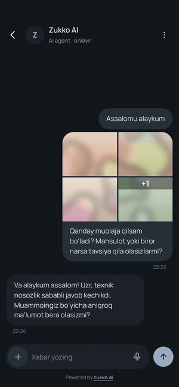
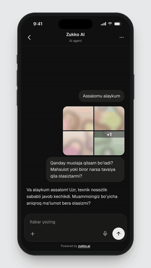
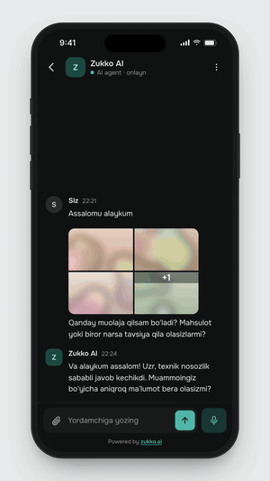

<p align="center">
  <a href="https://flutter.dev"></a>
  &nbsp;&nbsp;&nbsp;
  <a href="https://www.chatwoot.com"></a>
  &nbsp;&nbsp;&nbsp;
  <a href="https://zukko.ai/en"></a>
</p>

# Zukko Chat Flutter SDK

A native Flutter chat screen for [Zukko Chat](https://zukko.ai/en). Drop in one widget and your users can talk to your support team or AI agent in real time, with text, photos, files and voice messages. iOS and Android.

## Styles

Pick a look with `ZukkoChatOptions.style`. Each style has light and dark variants.

### Smooth Silk

Tonal bubbles that blend into the background, floating composer (default).

<p align="center"></p>

[Full-quality video](assets/videos/zukko-chat-smooth-silk.mp4)

```dart
class SmoothSilkScreen extends StatelessWidget {
  const SmoothSilkScreen({super.key, required this.user});

  final ZukkoChatUser user; // from your login, see "User identity"

  @override
  Widget build(BuildContext context) {
    return ZukkoChat(
      title: 'Support',
      options: ZukkoChatOptions(
        baseUrl: const String.fromEnvironment('ZUKKO_BASE_URL'),
        websiteToken: const String.fromEnvironment('ZUKKO_WEBSITE_TOKEN'),
        style: ZukkoChatStyle.smoothSilk,
        l10n: ZukkoChatL10n.uzLatn,
        user: user,
        theme: ZukkoChatTheme(brightness: Theme.of(context).brightness),
      ),
      interactions: ZukkoChatInteractions(onMorePressed: () {}),
    );
  }
}
```

### Minimal Clean

Agent replies as plain text, only the user's messages in bubbles.

<p align="center"></p>

[Full-quality video](assets/videos/zukko-chat-minimal-clean.mp4)

```dart
class MinimalCleanScreen extends StatelessWidget {
  const MinimalCleanScreen({super.key, required this.user});

  final ZukkoChatUser user; // from your login, see "User identity"

  @override
  Widget build(BuildContext context) {
    return ZukkoChat(
      title: 'Support',
      options: ZukkoChatOptions(
        baseUrl: const String.fromEnvironment('ZUKKO_BASE_URL'),
        websiteToken: const String.fromEnvironment('ZUKKO_WEBSITE_TOKEN'),
        style: ZukkoChatStyle.minimalClean,
        l10n: ZukkoChatL10n.uzLatn,
        user: user,
        theme: ZukkoChatTheme(brightness: Theme.of(context).brightness),
      ),
      interactions: ZukkoChatInteractions(onMorePressed: () {}),
    );
  }
}
```

### Thread Feed

Full-width rows with avatar and name, no bubbles.

<p align="center"></p>

[Full-quality video](assets/videos/zukko-chat-thread-feed.mp4)

```dart
class ThreadFeedScreen extends StatelessWidget {
  const ThreadFeedScreen({super.key, required this.user});

  final ZukkoChatUser user; // from your login, see "User identity"

  @override
  Widget build(BuildContext context) {
    return ZukkoChat(
      title: 'Support',
      options: ZukkoChatOptions(
        baseUrl: const String.fromEnvironment('ZUKKO_BASE_URL'),
        websiteToken: const String.fromEnvironment('ZUKKO_WEBSITE_TOKEN'),
        style: ZukkoChatStyle.threadFeed,
        l10n: ZukkoChatL10n.uzLatn,
        user: user,
        theme: ZukkoChatTheme(brightness: Theme.of(context).brightness),
      ),
      interactions: ZukkoChatInteractions(onMorePressed: () {}),
    );
  }
}
```

## Features

- One widget (`ZukkoChat`) or a headless client (`ZukkoChatClient`) if you build your own UI.
- Three looks, each with light and dark variants: `smoothSilk` (default), `minimalClean`, `threadFeed`.
- Real-time messages, typing indicator, online status, connection banner, automatic reconnect with missed-message catch-up.
- Attachments (photos, files) and hold-to-record voice messages.
- Markdown in agent and AI replies (the visitor's own messages stay plain text).
- Link previews (optional).
- Secure user identity (HMAC) so a user keeps the same history on every device.
- Encrypted on-device cache of the session and the newest 20 messages (optional).
- Localization: English, Russian, Uzbek (Latin and Cyrillic), Turkish, Karakalpak.
- No storage or media permissions: the system pickers are used.

## Contents

1. [Styles](#styles)
2. [Requirements](#requirements)
3. [Installation](#installation)
4. [Platform setup](#platform-setup)
5. [Get your baseUrl and websiteToken](#get-your-baseurl-and-websitetoken)
6. [Quick start](#quick-start)
7. [User identity (HMAC)](#user-identity-hmac)
8. [Logout](#logout)
9. [Configuration reference](#configuration-reference)
10. [Callbacks and errors](#callbacks-and-errors)
11. [Behavior details](#behavior-details)
12. [Headless client](#headless-client)
13. [Troubleshooting / FAQ](#troubleshooting--faq)
14. [Example app](#example-app)
15. [License](#license)

## Requirements

| | Minimum |
|---|---|
| Flutter | 3.47 |
| Dart | 3.13 |
| iOS | 15.0 |
| Android | API 24 (Android 7.0): the minimum of the `record`, `flutter_secure_storage` and `url_launcher` plugins the SDK uses, and Flutter's default `minSdkVersion` |

## Installation

Add the package:

```yaml
dependencies:
  zukko_chat_flutter: ^0.1.0
```

```
flutter pub get
```

(For local testing a `path:` dependency pointing at a checkout of this repository works too.)

```dart
import 'package:zukko_chat_flutter/zukko_chat_flutter.dart';
```

## Platform setup

### Android

Open `android/app/src/main/AndroidManifest.xml` and add, inside `<manifest>`:

```xml
<uses-permission android:name="android.permission.INTERNET"/>
<!-- Only if you keep voice messages enabled (enableVoiceMessages: true). -->
<uses-permission android:name="android.permission.RECORD_AUDIO"/>
```

The microphone permission is requested at runtime by the system the first time the user records.

### iOS

1. In `ios/Podfile` make sure the platform is at least 15.0:

   ```ruby
   platform :ios, '15.0'
   ```

2. In `ios/Runner/Info.plist` add the microphone usage text (only needed when voice messages are enabled; without it iOS terminates the app when recording starts):

   ```xml
   <key>NSMicrophoneUsageDescription</key>
   <string>Record voice messages in chat.</string>
   ```

3. Run `cd ios && pod install` (or just `flutter run`).

### No storage permissions

The SDK never needs `READ_MEDIA_*` or `READ/WRITE_EXTERNAL_STORAGE`. Photos and files are chosen through the system pickers.

If you do not use voice messages, set `enableVoiceMessages: false` and skip the microphone entries.

## Get your baseUrl and websiteToken

1. Open the Zukko Chat admin panel.
2. Go to Settings, then Inboxes, then your website inbox, then Configuration.
3. The web widget snippet shown there contains both values: `websiteToken` and `BASE_URL`.

Rules:

- `baseUrl` must be `https://...`. Plain `http`, even for localhost, is rejected (an `ArgumentError` is thrown).
- `websiteToken` is public. It identifies the inbox and is not a secret.

Keep both outside your source with `--dart-define`:

```
flutter run \
  --dart-define=ZUKKO_BASE_URL=https://chat.example.com \
  --dart-define=ZUKKO_WEBSITE_TOKEN=your-website-token
```

```dart
const baseUrl = String.fromEnvironment('ZUKKO_BASE_URL');
const websiteToken = String.fromEnvironment('ZUKKO_WEBSITE_TOKEN');
```

## Quick start

Minimal, anonymous visitor:

```dart
import 'package:flutter/material.dart';
import 'package:zukko_chat_flutter/zukko_chat_flutter.dart';

void openSupport(BuildContext context) {
  Navigator.of(context).push(
    MaterialPageRoute<void>(
      builder: (_) => const ZukkoChat(
        options: ZukkoChatOptions(
          baseUrl: 'https://chat.example.com',
          websiteToken: 'your-website-token',
        ),
      ),
    ),
  );
}
```

`ZukkoChat` is a full-screen page. It creates the client, connects, loads history and disposes everything when it leaves the tree. A back button is shown automatically when the page can be popped.

Full example with every parameter:

```dart
import 'package:flutter/material.dart';
import 'package:intl/intl.dart';
import 'package:zukko_chat_flutter/zukko_chat_flutter.dart';

const baseUrl = String.fromEnvironment('ZUKKO_BASE_URL');
const websiteToken = String.fromEnvironment('ZUKKO_WEBSITE_TOKEN');

Widget buildChat({required String userId, required String userHash}) {
  return ZukkoChat(
    title: 'Support', // header title; default is the localized "Support"
    options: ZukkoChatOptions(
      baseUrl: baseUrl, // https only
      websiteToken: websiteToken, // inbox token (public)
      enablePersistence: true, // encrypted on-device cache; false = memory only
      user: ZukkoChatUser(
        identifier: userId, // stable and unique per user in your system
        identifierHash: userHash, // HMAC computed by YOUR backend
        name: 'Aziz Karimov',
        email: 'aziz@example.com',
        phoneNumber: '+998901234567', // E.164
        avatarUrl: 'https://example.com/avatars/aziz.png',
        customAttributes: {'plan': 'pro'},
      ),
      style: ZukkoChatStyle.smoothSilk, // smoothSilk | minimalClean | threadFeed
      theme: const ZukkoChatTheme(
        brightness: Brightness.light, // light or dark variant
        accentColor: Color(0xFF0A7AFF), // send button, links
        horizontalPadding: 16,
      ),
      l10n: ZukkoChatL10n.uzLatn, // omit to follow the app locale
      timeFormat: DateFormat.Hm(), // message time format
      enableAttachments: true, // photo / file button
      enableVoiceMessages: true, // hold-to-record microphone
      enableLinkPreviews: true, // fetch preview cards for links
    ),
    callbacks: ZukkoChatCallbacks(
      onError: (e) => debugPrint('chat error: ${e.type.wire} ${e.cause}'),
      onMessageReceived: (m) => debugPrint('new message from an agent'),
      onConnectionStateChanged: (s) => debugPrint('connection: $s'),
    ),
    interactions: ZukkoChatInteractions(
      onMessageTap: (message) {},
      onSendPressed: (text) {},
      onMorePressed: () {}, // shows the header menu button
    ),
  );
}
```

## User identity (HMAC)

> [!IMPORTANT]
> **Identity validation (HMAC).** If "Enforce identity validation" is turned on for your inbox in Zukko Chat, every user you pass with an `identifier` also needs a correct `identifierHash`. Without it the chat does not open: the screen shows "Your account could not be verified", `onError` receives `INVALID_IDENTIFIER_HASH`, and the debug console prints exactly one line:
>
> ```
> [zukko_chat] ERROR: Identity validation is enabled for this inbox, but identifierHash is missing for user.identifier. Compute HMAC-SHA256(<inbox HMAC token>, identifier) on your backend and pass it as ZukkoChatUser.identifierHash.
> ```
>
> It says `wrong` instead of `missing` when a hash was sent but does not match. If the setting is off and you send no hash, the SDK stays silent and the chat works.
>
> **What you need to generate the hash**
>
> 1. The inbox **HMAC token**: Zukko Chat admin → Settings → Inboxes → your inbox → Configuration → "Identity validation". Use the inbox that `websiteToken` belongs to.
> 2. The **exact** `identifier` string your app passes (same case, no spaces; `42` and `"42 "` are different).
> 3. For a quick test: `openssl` (preinstalled on macOS and Linux; on Windows use Git Bash).
>
> **Generate it (testing only)**
>
> ```
> printf '%s' 'user-42' | openssl dgst -sha256 -hmac 'YOUR_HMAC_TOKEN'
> ```
>
> Copy only the 64-character hex value (ignore a `SHA2-256(stdin)=` or `(stdin)=` prefix) into `identifierHash`. Use `printf` or `echo -n`: a plain `echo` adds a newline and produces a different hash.
>
> **If you see the ERROR**
>
> - `missing`: pass `identifierHash` together with `identifier`.
> - `wrong`: check that the hash was computed over the same `identifier`, with the HMAC token of the same inbox, as lowercase hex, without a trailing newline, and that the token was not regenerated in the admin (that invalidates all old hashes).
>
> **In production** compute the hash on your backend and return it with your login response (see [How to produce it](#how-to-produce-it)). Never put the HMAC token in the app.

Without a user the visitor is anonymous. To tie the chat to one of your users, pass a `ZukkoChatUser`:

| Field | Type | What it does |
|---|---|---|
| `identifier` | `String?` | Your id for the user. Must be stable and unique per user (user id, not email that can change). |
| `identifierHash` | `String?` | Proof of identity: hex HMAC-SHA256 of `identifier`, computed on your backend. |
| `name` | `String?` | Display name shown to agents. |
| `email` | `String?` | Email shown to agents. |
| `phoneNumber` | `String?` | Phone in E.164 format, for example `+998901234567`. |
| `avatarUrl` | `String?` | URL of the profile picture. |
| `customAttributes` | `Map<String, dynamic>?` | Any extra attributes attached to the contact. |

`identifierHash` and `customAttributes` are never written to the device.

### Why the hash matters

1. It proves the user is who they say. Without it anyone could send someone else's `identifier`, appear as that customer to agents and the AI, and overwrite their name, email and phone.
2. With a verified identity the same user sees the same history on a new phone, after reinstall, and after logout then login. Without a hash each device starts with an empty conversation.

### How to produce it

1. Find the HMAC token: Zukko Chat admin, Settings, Inboxes, your inbox, Configuration, "Identity validation".
2. Compute `HMAC-SHA256(hmacToken, identifier)` as a hex string **on your backend**. The HMAC token must never be shipped in the app or fetched by it.
3. Return the hash to the app with your login response and pass it as `identifierHash`.

Node.js:

```js
const crypto = require('crypto');
const hash = crypto.createHmac('sha256', process.env.ZUKKO_HMAC_TOKEN)
  .update(String(user.id)).digest('hex');
```

Python:

```python
import hmac, hashlib
h = hmac.new(HMAC_TOKEN.encode(), str(user.id).encode(), hashlib.sha256).hexdigest()
```

PHP:

```php
$hash = hash_hmac('sha256', (string) $user->id, $hmacToken);
```

Quick check from a terminal:

```
printf '%s' 'user-42' | openssl dgst -sha256 -hmac 'YOUR_HMAC_TOKEN'
```

### "Enforce identity validation" setting

| Inbox setting | Hash | Result |
|---|---|---|
| On | missing or wrong | The chat does not open. A banner shows "Your account could not be verified" (localized), `onError` receives `INVALID_IDENTIFIER_HASH`, and exactly one `ERROR` line is written to the debug log. No anonymous fallback. |
| On | correct | Works. |
| Off | missing | Works silently: no `onError`, no log line (but no cross-device history). |
| Off | correct | Works. |

### Session token

The SDK obtains the session token (JWT) itself and keeps it encrypted in the local database; the encryption key lives in the iOS Keychain / Android Keystore. Your app never handles or sees it.

## Logout

When your user logs out:

1. Close the chat (pop the `ZukkoChat` page, or call `dispose()` on a headless client).
2. Forget the user's local data:

```dart
await zukkoChatSignOut(
  baseUrl: baseUrl,
  websiteToken: websiteToken,
  user: currentUser, // the same ZukkoChatUser passed to the chat
);
```

This removes the cached session, conversation and messages of that `identifier`, whatever hash it was stored with. Other users and inboxes are untouched. After the next login with a correct hash the user gets the server-side history back.

If the chat was ever opened without a user (anonymous), wipe everything instead:

```dart
await ZukkoChatClient.clearAllData();
```

Both can be called before any chat was created.

## Configuration reference

### ZukkoChat

| Parameter | Type | Default | What it does |
|---|---|---|---|
| `options` | `ZukkoChatOptions` | required | Connection and look, see below. |
| `title` | `String?` | localized header title | Title in the chat header. |
| `callbacks` | `ZukkoChatCallbacks?` | none | Client events, see [Callbacks](#callbacks-and-errors). |
| `interactions` | `ZukkoChatInteractions` | all empty | UI events, see below. |

### ZukkoChatOptions

| Parameter | Type | Default | What it does |
|---|---|---|---|
| `baseUrl` | `String` | required | Your Zukko Chat server, `https` only. |
| `websiteToken` | `String` | required | Token of the website inbox. |
| `enablePersistence` | `bool` | `true` | `true`: session and the newest 20 messages are cached encrypted on the device. `false`: memory only, a new session on every open. |
| `user` | `ZukkoChatUser?` | `null` | Identity of the user; `null` is an anonymous visitor. |
| `style` | `ZukkoChatStyle` | `smoothSilk` | `smoothSilk`: tonal bubbles and a floating composer. `minimalClean`: agent replies as plain text, only the user's messages in bubbles. `threadFeed`: full-width rows with avatar and name, no bubbles. |
| `theme` | `ZukkoChatTheme?` | see below | Brightness and overrides. |
| `l10n` | `ZukkoChatL10n?` | by app locale | Texts. `null` picks the built-in translation of the ambient locale (English if none). |
| `timeFormat` | `DateFormat?` | `DateFormat.Hm()` | Format of the time on messages. |
| `enableAttachments` | `bool` | `true` | Show the attachment button. |
| `enableVoiceMessages` | `bool` | `true` | Show the hold-to-record microphone. Needs the microphone entries from [Platform setup](#platform-setup). |
| `enableLinkPreviews` | `bool` | `true` | Preview card (title, description, image) for the first link of a message. If the server did not send preview data, the device itself does a plain `GET` of the `http(s)` link (no cookies, no SDK headers, no session token; at most 3 redirects, 5 s, first 512 KB of HTML) and reads the Open Graph tags; the preview image, if any, must be `https` and is loaded from that site too. This reveals the device's IP address to the linked site; turn off for privacy. Without it a link still shows its domain. |

If `options` changes with the same `baseUrl`, `websiteToken`, `enablePersistence` and `user`, the running connection is kept; changing any of those starts a new client.

### ZukkoChatTheme

If `options.theme` is null, the theme registered in `ThemeData.extensions` is used, else one derived from the ambient `ThemeData` (so dark mode follows your app).

| Parameter | Type | Default | What it does |
|---|---|---|---|
| `brightness` | `Brightness` | required | Light or dark variant of the style. |
| `fontFamily` | `String?` | style's own font | Forces one font on all chat text. Bundled: Manrope (smoothSilk), Geist (minimalClean), Onest (threadFeed). |
| `accentColor` | `Color?` | style's own | Overrides the accent (send button, links). |
| `backgroundColor` | `Color?` | style's own | Overrides the chat background. |
| `horizontalPadding` | `double` | `16` | Gap between the screen edge and messages / composer. |

Helpers: `ZukkoChatTheme.fromColorScheme(scheme)`, `ZukkoChatTheme.fromThemeData(theme)`.

### ZukkoChatInteractions

| Parameter | Type | What it does |
|---|---|---|
| `onEndReached` | `Future<void> Function()?` | Called when the top of the list (oldest message) is reached. Older history loads by itself; this is only a hook. |
| `onEndReachedThreshold` | `double?` | Fraction (0..1) of the list at which `onEndReached` (and the built-in loading of older messages) triggers. Default `0.01`, that is, at the very top. |
| `onMessageTap` | `void Function(Message)?` | A message was tapped. |
| `onMessageLongPress` | `void Function(BuildContext, Message)?` | A message was long-pressed. |
| `onSendPressed` | `void Function(String text)?` | Called with the text the user sent. |
| `onMorePressed` | `VoidCallback?` | Menu button of the header; the button is hidden when null. |

### Localization

Built in: `ZukkoChatL10n` (English, the default), `ZukkoChatL10n.ru`, `.uzLatn`, `.uzCyrl`, `.tr`, `.kaa` (Karakalpak). `ZukkoChatL10n.forLocale(locale)` picks one (Uzbek is Latin unless the locale script is `Cyrl`). Leave `l10n` null to follow the app locale automatically, or pass one explicitly. Every text of the UI is a field of `ZukkoChatL10n`, so you can build your own with the constructor.

### Limits (`ZukkoChatUpload`)

| Limit | Value |
|---|---|
| Message text | 150000 characters (`ZukkoChatUpload.maxMessageLength`) |
| Attachments per message | 15 (`maxAttachments`) |
| Size per attachment | 40 MB (`maxSizeMb`) |
| Accepted types | any image, video and audio, plus PDF, Office and OpenDocument documents, text/CSV/RTF/JSON, ZIP / 7z / RAR / TAR (`acceptedDocumentTypes`) |
| Voice message length | 5 minutes |

The UI shows a localized message when a limit is hit.

## Callbacks and errors

### ZukkoChatCallbacks

All optional. A callback that throws never breaks the SDK.

| Callback | Signature | Fires when |
|---|---|---|
| `onWelcome` | `()` | Realtime connection greeted the client. |
| `onPing` | `()` | Server keep-alive ping. |
| `onConfirmedSubscription` | `()` | Realtime subscription confirmed. |
| `onConnectionStateChanged` | `(ZukkoChatConnectionState)` | The realtime connection changed state: `idle`, `connecting`, `connected`, `subscribed`, `backoff`, `closed`. Missed messages are refetched automatically once it is `subscribed` again. |
| `onMessageReceived` | `(ZukkoChatMessage)` | A message from someone else (agent, AI) arrived. |
| `onMessageSent` | `(ZukkoChatMessage, String echoId)` | Your sent message was accepted by the server. |
| `onMessageDelivered` | `(ZukkoChatMessage, String)` | A message created by the current user came back over realtime. |
| `onMessageUpdated` | `(ZukkoChatMessage)` | A message changed. |
| `onPersistedMessagesRetrieved` | `(List<ZukkoChatMessage>)` | Cached messages were read from the device. |
| `onMessagesRetrieved` | `(List<ZukkoChatMessage>)` | Messages were fetched from the server. |
| `onConversationStartedTyping` / `onConversationStoppedTyping` | `()` | An agent started typing / stopped (typing-off event, the agent's message arrived, the conversation was resolved, or 30 s without another typing event). Fires only on changes, not on every event. |
| `onConversationIsOnline` / `onConversationIsOffline` | `()` | Presence update from the server: online when an agent is online, offline otherwise or after 40 s without an online update. Fired on each presence update, not only on change. |
| `onConversationResolved` | `()` | The conversation's status became `resolved` through a realtime event (once per resolve). The visitor can keep writing. |
| `onConversationUpdated` | `(ZukkoChatConversation)` | The current conversation is known or changed: once after the conversation is fetched at start (also after a session reset or a late start; not when the contact has no conversation yet), and on each realtime `conversation.created / updated / status_changed` event of the contact's inbox. |
| `onSessionReset` | `()` | The old session was replaced by a new contact; shown messages are dropped and the latest page is fetched. |
| `onError` | `(ZukkoChatException)` | Any failure, see below. |

### Errors

`ZukkoChatException` has `cause` (human text, never secrets), `type` (`ZukkoChatExceptionType`), `data` (for a failed send: the message's `echoId`), and optional `error` / `stackTrace`. `type.wire` is a stable string code.

| Type | Wire code | When |
|---|---|---|
| `getConfigFailed` | `GET_CONFIG_FAILED` | Starting the session (`/config`) failed or returned an unusable answer. |
| `createClientFailed` | `CREATE_CLIENT_FAILED` | The client could not be created. |
| `invalidIdentifierHash` | `INVALID_IDENTIFIER_HASH` | The inbox enforces identity validation and the hash is missing or wrong. Terminal: no anonymous fallback, no realtime. |
| `identifyFailed` | `IDENTIFY_FAILED` | Attaching the user failed (server error, timeout, 404, 422). The session is not usable (no sends, no realtime); the next start retries. For a user without `identifier` it is only a warning. |
| `sessionExpired` | `SESSION_EXPIRED` | The session could not be kept alive (server keeps rejecting the token or the widget is unavailable). |
| `socketSubscriptionRejected` | `SOCKET_SUBSCRIPTION_REJECTED` | The server did not accept the realtime subscription. |
| `socketDisconnected` | `SOCKET_DISCONNECTED` | The server closed the realtime connection and asked not to reconnect. |
| `getMessagesFailed` | `GET_MESSAGES_FAILED` | Loading messages failed. |
| `getConversationFailed` | `GET_CONVERSATION_FAILED` | Loading the conversation failed. |
| `sendMessageFailed` | `SEND_MESSAGE_FAILED` | Sending failed; `data` is the `echoId`. |
| `updateContactFailed` | `UPDATE_CONTACT_FAILED` | Updating the contact failed. |
| `storageFailed` | `STORAGE_FAILED` | Local storage could not be opened. The chat keeps working without persistence. |
| `identityNotVerified` | `IDENTITY_NOT_VERIFIED` | No longer emitted; kept so existing `switch` code compiles. |

## Behavior details

- **History paging.** On open the newest 20 messages are loaded; older pages load automatically as the user scrolls to the top. Only the newest 20 are cached on the device; older pages are kept in memory only and are fetched again on the next open. The app has nothing to do.
- **Auto-scroll.** A new message scrolls the list to the end when it is the user's own, or when the user is within about one screen of the end. A user reading far up history is not moved.
- **Markdown.** Agent and AI messages render Markdown; the visitor's own messages are always plain text.
- **Connection banner.** Offline and reconnecting states are shown in the chat; on reconnect the SDK refetches what was missed.
- **Footer.** The "Powered by zukko.ai" line under the composer is always shown and not configurable.
- **Voice.** The microphone button appears only when `enableVoiceMessages` is true and the inbox allows voice messages (`audio_messaging_enabled` is not false).
- **Debug log.** In debug builds the SDK prints lines prefixed `[zukko_chat]` at three levels: `ERROR:` (something you must fix, for example a wrong identity hash), `WARNING:` (recoverable) and plain info. Release builds print nothing. Tokens, JWTs and hashes are never logged.

## Headless client

Use `ZukkoChatClient` to build your own UI or to react to messages without a screen.

```dart
final client = await ZukkoChatClient.create(
  baseUrl: baseUrl,
  websiteToken: websiteToken,
  user: user,
  enablePersistence: true,
  callbacks: ZukkoChatCallbacks(
    onMessageReceived: (m) => debugPrint('new message'),
    onError: (e) => debugPrint(e.toString()),
  ),
);

await client.loadMessages();
await client.sendMessage(content: 'Hello', echoId: 'tmp-1');
// ...
await client.dispose();
```

| Member | What it does |
|---|---|
| `ZukkoChatClient.create({baseUrl, websiteToken, user, enablePersistence, callbacks})` | Connects (session, user, conversation). Throws `ArgumentError` for an invalid or non-https `baseUrl`; other failures arrive through `onError`. |
| `config` | Inbox branding and behavior (`ZukkoChatConfig`), null until the session exists. |
| `loadMessages()` | Loads cached then remote messages; fires the retrieved callbacks. |
| `loadOlderMessages({required int before})` | Up to 20 messages older than message id `before`, oldest first; fewer than 20 means no more. Returns null on failure. |
| `sendMessage({content, echoId, attachments, replyTo})` | Sends text and/or `ZukkoChatUpload` attachments. `echoId` is your temporary id, returned in `onMessageSent`. |
| `setTyping(bool)` / `markSeen()` | Typing indicator / read receipt (best effort). |
| `resume()` | Call when the app returns to the foreground to restart realtime if it stopped. |
| `sendAction(ZukkoChatActionType)` | Sends a presence action; `false` if the connection is not subscribed. |
| `clearClientData()` | Clears this client's conversation and messages (contact kept). |
| `dispose()` | Stops timers and sockets. Safe to call twice. |
| `ZukkoChatClient.clearData(...)` / `clearAllData()` | Static wipe of persisted data (what `zukkoChatSignOut` uses). |

## Troubleshooting / FAQ

**The chat shows "Your account could not be verified".**
Identity validation is enforced on the inbox and `identifierHash` is missing or wrong. Compute HMAC-SHA256 of the exact `identifier` string with the inbox HMAC token on your backend, hex-encoded. The debug log says which one it is ("missing" or "wrong").

**`ArgumentError` about `baseUrl`.**
Only `https://` is accepted, including for local development. Use an https tunnel or certificate for a dev server.

**The microphone button is missing.**
Either `enableVoiceMessages` is `false`, or voice messages are disabled for the inbox on the server (`audio_messaging_enabled: false`).

**The app crashes (iOS) or recording fails when I tap the microphone.**
Add `NSMicrophoneUsageDescription` (iOS) and `RECORD_AUDIO` (Android), see [Platform setup](#platform-setup).

**A user has no history on a new phone.**
Without a valid `identifierHash` each device is a separate visitor. Pass the hash from your backend.

**The chat is empty after logout and login.**
Expected: `zukkoChatSignOut` removes the local cache. With a verified identity the history comes back from the server on the next login.

**No debug output in release.**
By design, logging is debug-only.

**I need to see what the SDK does.**
Run a debug build and filter the console for `[zukko_chat]`.

## Example app

A runnable app lives in [`example/`](example/): [`example/lib/main.dart`](example/lib/main.dart) and the live chat screen [`example/lib/live/live_chat_screen.dart`](example/lib/live/live_chat_screen.dart). How to run it and where to get each value: [`example/README.md`](example/README.md). On pub.dev see the "Example" tab.

```
cd example
flutter run \
  --dart-define=ZUKKO_BASE_URL=https://chat.example.com \
  --dart-define=ZUKKO_WEBSITE_TOKEN=your-website-token \
  --dart-define=ZUKKO_USER_ID=user-42 \
  --dart-define=ZUKKO_USER_HASH=hex-hmac-of-user-id
```

`ZUKKO_USER_ID` and `ZUKKO_USER_HASH` are optional; without them the visitor is anonymous.

## License

MIT, see [LICENSE](LICENSE).
